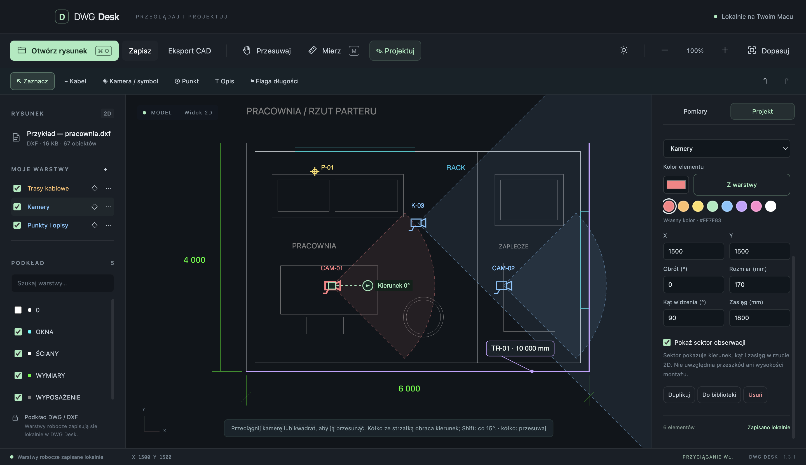

# DWG Desk

**Lokalny podgląd DWG/DXF, pomiary i projektowanie instalacji na Macu.**

DWG Desk pozwala otworzyć rysunek CAD, zmierzyć trasę i nanieść własne kable, kamery, punkty oraz opisy. Działa bez konta i bez wysyłania rysunków do internetu. Interfejs jest po polsku.

## Co potrafi

| Funkcja | Działanie |
| --- | --- |
| Podgląd DWG i DXF | Model 2D, przybliżanie, przesuwanie, dopasowanie i lista warstw. |
| Pomiary | Klikanie kolejnych punktów, długości odcinków, suma trasy i suma wszystkich pomiarów. |
| Jednostki | Automatyczne rozpoznawanie z danych rysunku, z możliwością ręcznego ustawienia. |
| Warstwy robocze | Własna nazwa, kolor, widoczność i blokada edycji. |
| Trasy kablowe | Polilinie z edytowalnymi wierzchołkami i flagami całkowitej długości. |
| Kamery i symbole | Wstawianie, przesuwanie, obrót, wskazywanie celu, kąt widzenia i zasięg. |
| Kolory elementów | Własny kolor kamery, kabla, symbolu, punktu lub opisu albo kolor dziedziczony z warstwy. |
| Lokalna biblioteka | Własne symbole i typy kabli do użycia na kolejnych rysunkach. |
| Eksport | DWG/DXF 2018 z podkładem lub sama instalacja, kontrast na białym tle i grubości linii; osobno CSV z pomiarami. |

**Podkład pozostaje niezmieniony.** Dodane elementy zapisują się jako lokalna nakładka. Aby przekazać rysunek z instalacją innej osobie, użyj **Zapisz DWG / DXF**.

## Wymagania i instalacja

Wydanie **1.3.3** przygotowano dla **macOS 13+ i Apple Silicon**. Nie przygotowano paczki dla komputerów Intel ani wydania Windows/Linux.

1. Otwórz plik `DWG-Desk-1.3.3-mac-arm64.dmg` otrzymany z wydaniem.
2. Przeciągnij **DWG Desk** do **Aplikacji**.
3. Uruchom program i wybierz **Otwórz rysunek** lub przeciągnij plik DWG/DXF do okna.

Do podglądu, pomiarów i projektowania nie jest potrzebny dodatkowy konwerter. **Eksport DWG/DXF wymaga osobno zainstalowanego [ODA File Converter](https://www.opendesign.com/guestfiles/oda_file_converter)** dla Apple Silicon.

Paczka jest podpisana lokalnie ad hoc, bez notaryzacji Apple. Szczegóły instalacji, aktualizacji i komunikatów macOS znajdziesz w [instrukcji instalacji](docs/installation.md). Jeśli nie masz instalatora, program można [uruchomić ze źródeł](docs/development.md).

## Pierwszy projekt

1. Otwórz podkład i sprawdź rozpoznaną jednostkę.
2. Włącz **Mierz**. Lewy przycisk dodaje punkty, prawy przycisk lub Enter kończy pomiar.
3. Wybierz **Projektuj** i dodaj kabel, kamerę albo punkt.
4. Zaznacz element, aby zmienić jego właściwości i kolor. Kamerę możesz przesunąć myszą lub obrócić uchwytem kierunku.
5. Kliknij **Zapisz DWG / DXF** lub naciśnij **Cmd+S**, zostaw zaznaczone **Dołącz podkład DWG / DXF** i zapisz nowy plik. W innym programie CAD otwórz właśnie ten plik. Projekt DWG Desk zapisuje się lokalnie automatycznie.

Możesz też wybrać **Wypróbuj na rysunku przykładowym** i sprawdzić funkcje bez własnego pliku.

## Dokumentacja

- [Instalacja i aktualizacja](docs/installation.md)
- [Instrukcja obsługi i skróty](docs/user-guide.md)
- [Zapis danych, kopie zapasowe i eksport CAD](docs/data-and-export.md)
- [Uruchamianie, architektura, testy i budowanie](docs/development.md)
- [Rozwiązywanie problemów i ograniczenia](docs/troubleshooting.md)
- [Historia zmian](CHANGELOG.md)
- [Wprowadzanie zmian w projekcie](CONTRIBUTING.md)

## Zakres i ograniczenia

DWG Desk pracuje w modelu 2D. Nie edytuje źródłowych obiektów podkładu, nie modeluje w 3D i nie obsługuje układów arkuszy. Nietypowe encje, obiekty proxy/AEC, fonty i zewnętrzne odnośniki mogą wymagać innego programu CAD. Uwagi o odczycie są pokazywane w aplikacji.

Sektor kamery jest rzutem geometrycznym — nie uwzględnia przeszkód ani wysokości montażu. Długość kabla jest długością trasy XY, bez zapasu. Flagi w wyeksportowanym CAD zawierają długość z chwili eksportu.

## Weryfikacja wydania

W wersji 1.3.3 przeszły **32 testy logiki i 20 kontroli eksportu spakowanej aplikacji**. Weryfikacja obejmuje kontrast na białym tle, grubości linii i szerokości polilinii po konwersji DWG/DXF, zapamiętywanie ustawień oraz dotychczasowy zapis CAD. [Raport 1.3.3](docs/validation-1.3.3.json) podaje wyniki. Wcześniejsze raporty: [1.3.2](docs/validation-1.3.2.json) i [1.3.1](docs/validation-1.3.1.json). Raporty nie są deklaracją zgodności ze wszystkimi plikami DWG.

## Licencja

Kod aplikacji: **AGPL-3.0-only** — [LICENSE](LICENSE). Wykaz zależności i ich licencji znajduje się w [THIRD-PARTY-NOTICES.txt](THIRD-PARTY-NOTICES.txt).

Podgląd korzysta z `@flyfish-dev/cad-viewer` oraz LibreDWG w WebAssembly. ODA File Converter jest oddzielnym programem z własną licencją i nie jest dołączony do repozytorium ani instalatora DWG Desk.
