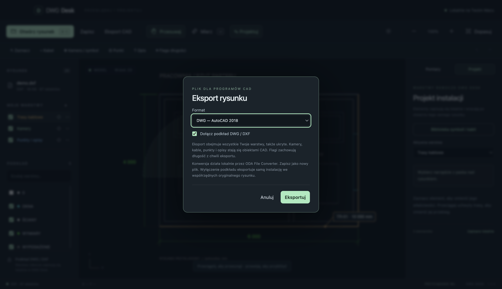

# Zapis danych i eksport

[← README](../README.md)

## Co zapisuje program

Podkład DWG/DXF jest otwierany do odczytu. Kamery, kable, punkty, opisy, flagi i własne warstwy tworzą **nakładkę DWG Desk**. Program zapisuje ją automatycznie po zmianach; przycisk **Zapisz** lub Cmd+S wymusza zapis. Rozpoczęta trasa z co najmniej dwoma punktami jest kończona przy zapisie, zmianie pliku i zamykaniu aplikacji.

Nakładka zawiera geometrię, nazwy, parametry kamer, kolory, widoczność i blokady warstw oraz ustawienia jednostek. Biblioteka symboli i typów kabli jest wspólna dla wszystkich rysunków. Pomiary i historia cofania są tymczasowe — pomiary można wcześniej wyeksportować do CSV.

Projekt jest identyfikowany przez SHA-256 **zawartości podkładu**. Kopia lub zmiana nazwy identycznego pliku otworzy tę samą nakładkę. Edycja pliku w innym programie zmienia jego identyfikator; dotychczasowa nakładka nie zostanie wtedy automatycznie przypisana do zmienionego podkładu.

## Lokalizacja danych

W standardowym profilu macOS dane znajdują się w katalogu użytkownika:

```text
~/Library/Application Support/dwg-desk/designs/
├── library.json
└── drawings/
    └── <sha256-podkładu>.json
```

Aplikacja korzysta z katalogu `app.getPath('userData')`; testy mogą wskazać osobny profil przez `DWG_DESK_USER_DATA`. Pliki zapisują się przez plik tymczasowy i zmianę nazwy. Błąd zapisu jest wyświetlany w aplikacji i blokuje zamknięcie z niezapisanymi zmianami.

## Kopia zapasowa

1. Kliknij **Zapisz** i zamknij aplikację.
2. Zachowaj kopię oryginalnych podkładów DWG/DXF.
3. Skopiuj cały katalog `designs`, łącznie z biblioteką.
4. Przy odtwarzaniu zamknij program i przywróć katalog do tego samego profilu. Następnie otwórz niezmieniony podkład.

Sam podkład nie zawiera lokalnej nakładki. Sam plik JSON nakładki nie zawiera podkładu. Aby przekazać projekt jako zwykły plik CAD, użyj eksportu.

## Eksport DWG i DXF

Eksport obu formatów wymaga [ODA File Converter](https://www.opendesign.com/guestfiles/oda_file_converter), zainstalowanego zgodnie z [instrukcją](installation.md#konwerter-do-eksportu-dwgdxf). Odczyt i projektowanie działają bez niego.



1. Sprawdź jednostkę rysunku i zakończ edycję elementów.
2. Wybierz **Eksport CAD**.
3. Wybierz **DWG** lub **DXF** oraz zakres: podkład z instalacją albo sama instalacja.
4. Wskaż nowy plik docelowy.
5. Poczekaj na komunikat zakończenia.

Wynik używa formatu **AutoCAD 2018**. Eksport zachowuje współrzędne i jednostkę modelu; nie skaluje rysunku do jednostki wyświetlania wyników. Wybranie otwartego pliku źródłowego jako celu jest blokowane.

| Element | Postać w wyeksportowanym CAD |
| --- | --- |
| Kabel | Edytowalna polilinia. |
| Kamera / symbol | Zwykła geometria symbolu i tekst opisu. |
| Pole widzenia | Kontur sektora zgodny z kierunkiem, kątem i zasięgiem. |
| Punkt i opis | Geometria oraz tekst. |
| Flaga kabla | Etykieta z długością z chwili eksportu i odnośnikiem. |
| Własna warstwa | Osobna warstwa z kolorem, widocznością i blokadą. |

Eksportowane są także ukryte warstwy robocze, z zachowaniem ich stanu. Nazwy warstw instalacji mają prefiks `DWGDesk_`; są normalizowane do znaków ASCII, a kolizje rozwiązywane numerem. Kolory RGB poszczególnych elementów pozostają zachowane. Przy eksporcie podkładu jego stany warstw pochodzą z pliku źródłowego — chwilowe ukrycie warstwy w przeglądarce nie usuwa jej z eksportu.

Program pracuje na kopiach tymczasowych. Konwerter działa lokalnie, z zablokowanym dostępem do sieci. Przed zapisaniem wyniku wykonywana jest kontrola struktury przez ponowną konwersję oraz porównanie liczby dodanych encji na warstwach; dla DWG sprawdzana jest także sygnatura pliku. To kontrola procesu eksportu, a nie gwarancja zachowania każdego nietypowego obiektu źródłowego.

## Dalsza edycja i ograniczenia

W innym programie CAD można edytować wynik jako zwykłą geometrię. Nie ma w nim zachowania biblioteki DWG Desk: zmiana polilinii nie aktualizuje automatycznie tekstu flagi, a sektor nie pozostaje parametrycznie powiązany z kamerą.

Aby kontynuować projekt z kamerami i dynamicznymi flagami w DWG Desk, otwórz **oryginalny podkład z jego lokalną nakładką**. Wyeksportowany plik ma inną zawartość i jest traktowany jako nowy rysunek.

Eksport nie dołącza zewnętrznych plików XREF ani fontów. Rysunek z nietypowymi encjami warto sprawdzić w docelowym programie CAD. Długości dotyczą płaszczyzny XY, bez wysokości i zapasu kabla.

## Eksport pomiarów CSV

Panel **Pomiary → Eksport CSV** zapisuje odcinki, współrzędne i podsumowania. CSV służy do zestawienia pomiarów; nie jest kopią nakładki ani zamiennikiem eksportu CAD.
